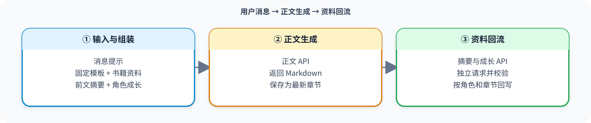
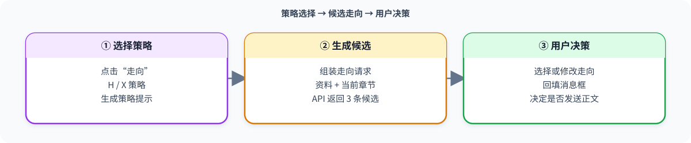
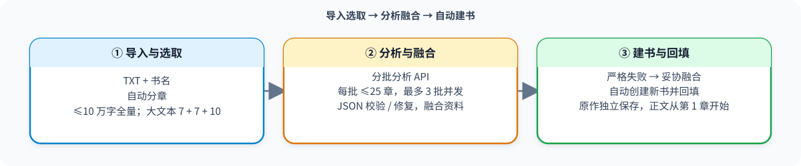

<p align="center">
  
</p>

<h1 align="center">AI 小说生成器 Android</h1>

<p align="center">
  <a href="https://github.com/xiaohuangya617/novel-writer-android/releases"></a>
  <a href="https://developer.android.com/about/versions/oreo"></a>
  <a href="LICENSE"></a>
</p>

一个面向长篇小说创作的 Android AI 工具。App 负责书籍、章节、角色、提示词、上下文整理和本地存档，模型负责根据这些资料生成正文、续写走向、摘要和角色成长。

**当前版本：1.47（正式版）** · 支持 Android 8.0 及以上 · [下载 APK](https://github.com/xiaohuangya617/novel-writer-android/releases/download/1.47/1.47.apk) · [查看全部发布](https://github.com/xiaohuangya617/novel-writer-android/releases)

## 快速开始

1. 下载并安装 APK，首次打开后新建书籍，或恢复 App 导出的项目存档。
2. 打开“AI 设置”，填写 API 地址、API Key 和模型并点击“测试”。默认配置为 DeepSeek 聊天补全接口和 `deepseek-flash`，也支持兼容该接口格式的服务商。
3. 填写世界观、主线大纲、写作提示和角色资料，在消息框输入本章要求后发送。

正文完成后，App 会继续请求摘要与角色成长并回写到书籍资料。使用“走向”时，App 先生成三条候选方向，选择后只会回填消息框，是否正式创作由用户决定。

1.47 将正文与摘要/角色成长的费用、合计字数、耗时和新增成长合并为一条统计通知，并调整书架操作按钮的布局。旧版 APK 会保留在 GitHub 发布归档中。

## 主要功能

### 书籍与创作资料

- 多书籍书架、章节列表、消息历史和草稿恢复。
- 世界观、主线大纲、写作提示、角色、动作、服装和全局禁用词。
- 本书角色成长按章节归档，最新成长状态会参与后续创作。
- 草稿本支持保存灵感和片段、编辑、复制正文和删除；复制正文不包含卡片标题，草稿不会被自动加入 AI 请求。

### 正文与走向

- 正文请求会按固定提示词、长期资料、近期摘要、角色成长、本次指令和前文顺序组装上下文。
- 正文完成后可独立整理摘要和角色成长，并显示费用、生成字数、耗时和新增成长数量。
- 支持三条独立剧情走向，以及 H/X 走向策略。走向结果不会未经确认直接生成正文。
- 生成过程中可以停止，失败请求可以重试。

### TXT 续写

- 导入 TXT，自动识别章节、选择原作范围并分批分析。
- 支持结构化 JSON 校验和修复、失败批次重试或跳过、资料融合和自动建书。
- 可提取文风、行文规范、世界观、主线、剧情断点和主要角色，并写入新书资料。
- 角色资料按姓名、外貌体征、性格、服装及其他设定、身份关联等字段回填。
- 原作资料会以“原作：TXT 文件名”保存到资料章节中，不计入正文统计；新书正文从第 1 章开始。

### 开发者与阅读功能

- 连续点击版本信息 7 次可解锁开发者选项，仅对当前会话有效。
- 可编辑实际发送给 API 的 12 个固定 Prompt，也可以单项或全部恢复默认。自定义 Prompt 支持动态占位符，并在所有书籍间共用。
- 支持 Markdown 正文、连续阅读、原作独立宽屏阅读和 TXT 导出范围选择。
- 支持 App 项目存档备份与恢复、导出 HTML 存档、检查 GitHub 更新、下载更新并交给系统安装。

## 创作链

三条创作链使用相同的资料组装规则：稳定的固定 Prompt 放在前部，书籍长期资料、近期摘要和角色成长随后注入，本次消息或待分析章节放在动态部分。

### 正文创作链



### 走向创作链



### 续写作品创作链



## 存档与跨端使用

App 提供两种 JSON 项目存档。它们用途不同，恢复前请确认文件类型；恢复操作会覆盖接收端现有项目，不会追加合并。

| 存档类型 | 用途 | 包含内容与边界 |
| --- | --- | --- |
| **项目存档（app）** | 在 Android App 中备份和恢复 | 书籍、章节、消息历史、本书角色与成长、创作资料、草稿本、字号、走向策略、开发者 Prompt 和 AI 设置（不含 API Key）。 |
| **项目存档（html）** | 交给 PC/Web 端继续创作 | 书籍、章节、消息历史、本书角色与成长、世界观、主线、写作提示，以及素材角色、动作、服装和禁用词等项目资料；不携带 App 草稿本、字号、走向策略或开发者 Prompt。 |
| **本书正文（txt）** | 阅读、传阅或另行编辑 | 只导出当前书籍正文，可选择“仅续作”或“含原作”，不包含角色和设定等完整资料。 |

### Android 导出到 PC/Web

1. 在 App 右上角打开“存档与分享”，选择“导出/分享项目存档（html）”。
2. 选择“导出”保存 JSON，或选择“分享”通过文件分享软件传到电脑。
3. 在 PC/Web 端打开恢复功能，选择该 JSON 并确认导入。
4. 检查书籍和创作资料，在 PC/Web 端重新填写 API Key 后继续创作。

新版 PC/Web 项目支持导入 Android 导出的 HTML 项目存档，并会保留世界观、主线大纲、全局提示词、行文规范、消息历史、章节正文和本书角色资料。旧版 [HTML 项目（novel-writer）](https://github.com/xiaohuangya617/novel-writer) 仍可使用，但与新版的数据字段和功能范围可能不同。

**当前不支持 PC/Web → Android 的反向恢复。** PC/Web 备份及 App 导出的 HTML 存档不能通过 Android App 的恢复入口导入；如果需要在手机上恢复，请保留并使用“项目存档（app）”。

两种 Android JSON 存档均不包含 API Key。API Key 使用 Android Keystore 加密保存在本机；恢复 App 存档后，需要在接收设备重新填写 Key。恢复旧版 App 存档时，App 会补齐缺少的默认字段和已登记的旧默认 Prompt，并保留用户自定义 Prompt。

## 数据与费用说明

- 书籍、章节、消息历史和资料默认保存在 App 的本地项目数据中。
- API Key 不写入项目存档，导出存档前无需手动脱敏 Key。
- API 费用由你使用的服务商收取；App 内显示的费用是根据接口返回用量和价格配置计算的估算值，不是账单。
- 生成内容的质量、速度和费用取决于 API 服务商、模型、上下文长度和请求参数。

## 构建与测试

需要以下环境：

- JDK 17
- Android SDK 35
- Gradle 8.9
- Node.js（用于 JavaScript 测试）

仓库未附带 Gradle Wrapper。构建调试包并运行测试：

```powershell
gradle assembleDebug

npm install
npm test
```

调试 APK 输出在 `app/build/outputs/apk/debug/`，正式 APK 输出在 `app/build/outputs/apk/release/`。正式包使用发布签名文件，签名材料不包含在仓库中；构建前通过 `NOVEL_RELEASE_PASSWORD` 提供密码。不要提交 API Key、签名密钥或 `local.properties`。

## 代码结构

- `app/src/main/assets/index.html`：Android WebView 界面、交互和本地状态管理。
- `app/src/main/assets/novel-core.js`：请求组装、资料注入、摘要成长和续写分析逻辑。
- `app/src/main/java/com/novelwriter/mobile/MainActivity.java`：WebView 容器和 JavaScript 桥接。
- `app/src/main/java/com/novelwriter/mobile/AiRequests.java`：AI 请求、取消和响应处理。
- `app/src/main/java/com/novelwriter/mobile/SecureStore.java`：API 设置和 Key 的安全存储。
- `app/src/main/java/com/novelwriter/mobile/UpdateManager.java`：GitHub 版本检查、下载和安装流程。
- `tests/`：Smoke 测试和续写资料分析回归测试。

## 更新历史

| 版本 | 主要变化 |
| --- | --- |
| **1.47** | 合并正文与摘要/角色成长统计通知；统计显示费用、合计字数、合计耗时和新增成长数量；书架操作按钮横向排列并将“新建作品”改名为“原创作品”。 |
| **1.46** | 草稿本卡片增加复制正文；正文、摘要与角色成长消息增加费用、生成字数和耗时统计，并显示新增成长数量。 |
| **1.45** | 优化动作库和服装库卡片按钮顺序与启用状态显示；增加批量操作后的快速到底部按钮。 |
| **1.44** | 普通新建作品禁止同名；动作库和服装库支持单卡与批量启用/屏蔽，新卡默认关闭。 |
| **1.43** | 新增草稿本、原作参考章节独立宽屏阅读、TXT 正文仅续作/含原作二次选择导出。 |
| **1.42** | 修复旧 Prompt 迁移、人物别名成长匹配、结构化 JSON 兼容、旧 profile 保留、人物重名合并和费用范围显示。 |
| **1.41** | 结构化提取人物资料并精准回填角色卡；保护自定义开发者 Prompt；调整续写消息和费用顺序。 |
| **1.40** | 优化续写融合规则、停止后的妥协建书、费用汇总和原作文件名显示。 |
| **1.39** | 续写资料融合严格校验失败时，可使用妥协融合并自动建书，尽量保留已生成资料。 |
| **1.38** | 隔离续写原作资料的第 0 章；修复章节编号、成长归档和章节统计。 |
| **1.36** | 正式启用增强版走向 System；优化摘要与成长请求的长期资料顺序，改善缓存前缀稳定性。 |
| **1.34** | 新增开发者选项，可查看、修改和恢复创作链提示词，并支持存档。 |
| **1.32** | 扩展 TXT 章节标题识别，支持序章、楔子、番外和更多数字格式。 |

## 开源许可

原创代码采用 [MIT License](LICENSE)。Font Awesome 和 markdown-it 保留各自许可证，见 `app/src/main/assets/FONT-AWESOME-LICENSE.txt` 与 `app/src/main/assets/MARKDOWN-IT-LICENSE.txt`。

## 新版 PC/Web 项目：Forge-novel-windows

Android 端适合移动创作；需要更大的编辑空间、IndexedDB 数据层或 Windows 桌面包时，建议使用新版项目：

- [源码仓库：Forge-novel-windows](https://github.com/xiaohuangya617/Forge-novel-windows)
- [在线网页版（GitHub Pages）](https://xiaohuangya617.github.io/Forge-novel-windows/)
- [Windows 版下载（Latest Release）](https://github.com/xiaohuangya617/Forge-novel-windows/releases/latest)

新版项目的主要能力包括：

- 9.0 IndexedDB 数据层，适合长期保存多本书和大量章节。
- HTML 网页版与 Windows Electron EXE，共用主要创作模块。
- HTML 与 EXE 项目存档互通，并支持导入 Android 导出的 HTML 项目存档。
- 导入时保留世界观、主线大纲、全局提示词、行文规范、消息历史、章节正文和本书角色资料。
- 提供 GitHub Pages 网页版、Windows Release 压缩包、构建脚本和离线测试。

Android 仓库地址和名称保持不变；新版 PC/Web 项目是面向桌面端的独立仓库，两个项目可以通过 HTML 项目存档传递创作资料。
